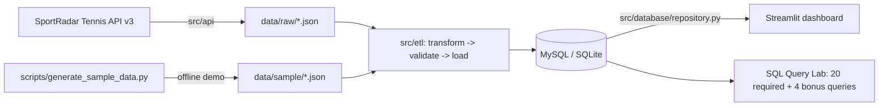

# Architecture

| Layer | Files | Responsibility |
|---|---|---|
| Extract | `src/api/` | Authenticated GET, retries on 429/5xx, atomic JSON save |
| Transform | `src/etl/transform.py` | Nested JSON -> flat DataFrames |
| Validate | `src/etl/validate.py` | Keys, duplicates, lengths, referential integrity |
| Load | `src/etl/loader.py` | One transaction; full refresh for dimensions, snapshot upsert for rankings |
| Serve | `src/database/repository.py` | Parameterised SQL (filters run in the database) |
| Present | `src/dashboard/` | 7 Streamlit pages, Plotly charts, rule-based insights |
