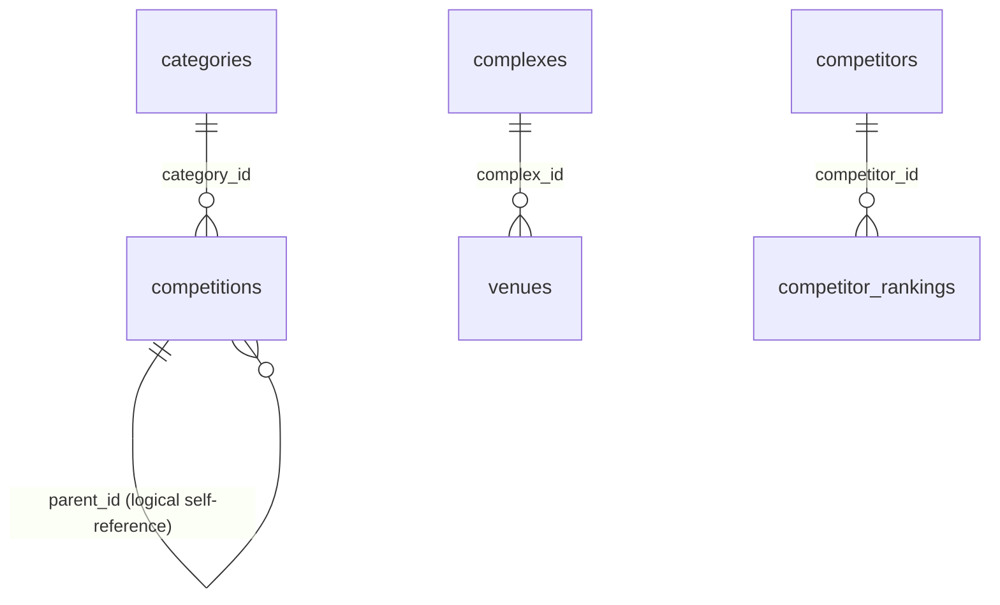

# Database design

| Table | Purpose | Key |
|---|---|---|
| categories | Competition categories (ATP, WTA, ITF Men...) | category_id |
| competitions | Competitions and sub-competitions | competition_id, FK category_id |
| complexes | Sports complexes | complex_id |
| venues | Venues inside a complex | venue_id, FK complex_id |
| competitors | Doubles players | competitor_id |
| competitor_rankings | Weekly ranking snapshots | rank_id (AUTO_INCREMENT), FK competitor_id |
| etl_runs | Audit log: source (api/sample), load time, row counts | run_id |
| v_latest_rankings (view) | Newest snapshot per tour | - |

## Design decisions
- **Normalised**: names of categories/complexes/competitors are stored once.
- **Brief + extras**: `competitor_rankings` adds `tour`, `gender`, `ranking_year`, `ranking_week` (the sample UI filters by year/week/gender) and a unique key on `(tour, year, week, competitor_id)` so reloads are idempotent and history accumulates week after week.
- **`parent_id` is not a foreign key**: the API may reference parents outside the returned list.
- **Indexes** on every foreign key, on `country`, `name`, `points`, `rank` and `(year, week)`.
- **`rank` is a reserved word in MySQL 8** and is always back-quoted.
- **Validation before load**: missing keys dropped, duplicates removed, text truncated to schema length, orphan foreign keys nulled/dropped, defaults for missing NOT NULL fields (`Unknown`, `UNK`).
